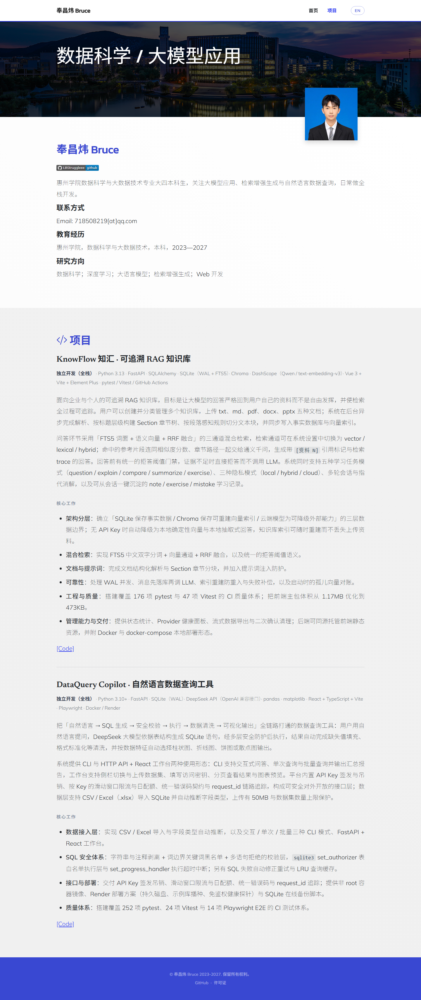

# 奉昌炜 Bruce's Homepage

个人主页，基于 [academic-homepage-template](https://github.com/senli1073/academic-homepage-template) 模板构建，支持中英文切换（导航栏右上角）。

## Preview

## About Me

我是惠州学院数据科学与大数据技术专业的大四本科生，研究方向包括数据科学、深度学习、大语言模型与 Web 开发。

## Projects

- **KnowFlow 知汇** — 面向企业与个人的可追溯 RAG 知识库，采用 FTS5 + 向量 + RRF 三通道混合检索，回答带引用标记与检索 trace，支持本地降级与索引重建。技术栈为 Python 3.13 + FastAPI + Chroma + Qwen + Vue 3。
- **DataQuery Copilot** — 基于 LLM 的自然语言数据查询工具，打通自然语言 → SQL → 安全校验 → 执行 → 清洗 → 可视化全链路。技术栈为 Python + FastAPI + DeepSeek API + React + TypeScript。

## Contact

- Email: 718508219@qq.com
- GitHub: [LBStruggleee](https://github.com/LBStruggleee)

## License

Copyright 奉昌炜 Bruce, 2023-2027. Licensed under an MIT license.
